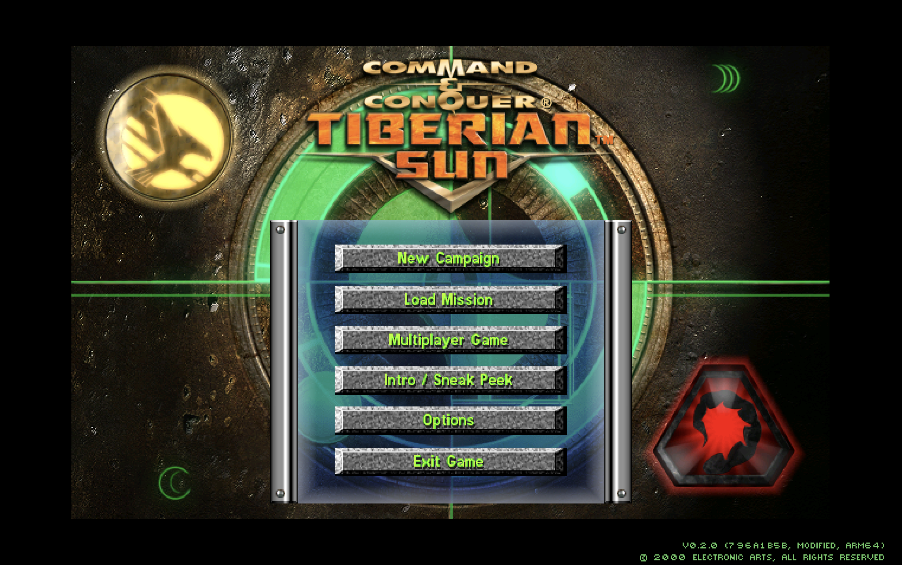
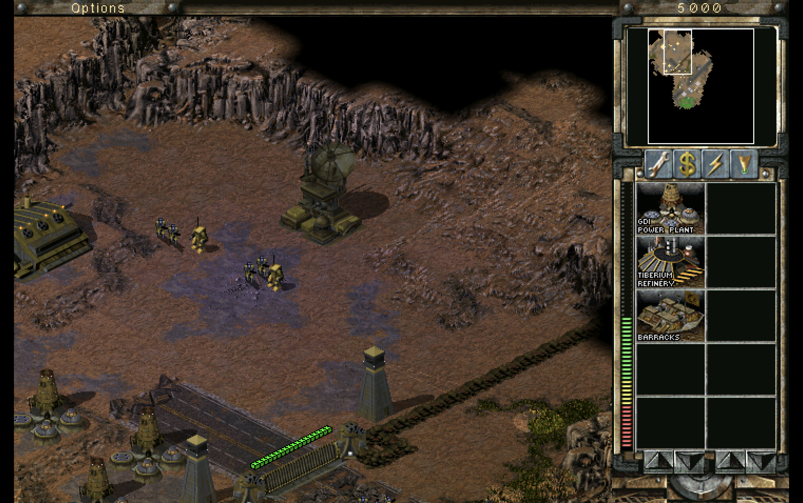

# siliconsun

siliconsun publishes a 64-bit Windows client and an Apple Silicon client of
*Command & Conquer: Tiberian Sun*. The engine is
[OpenTS](https://github.com/OpenTS-Developers/OpenTS).





## What this is

OpenTS rebuilds the Tiberian Sun engine as a standalone program instead of
patching the retail executable. siliconsun keeps that engine, adds an arm64
macOS build, and ships both clients from a tagged release. I play it on
Windows 11, on macOS, and on a Steam Deck (SteamOS, Proton 11).

Everything about the engine — what OpenTS is and is not, its status and
roadmap, the manual, history, and license — lives in the
[upstream README](https://github.com/OpenTS-Developers/OpenTS) and its
[documentation](https://github.com/OpenTS-Developers/OpenTS/tree/main/docs).
This file covers what siliconsun adds: building and running on macOS, where the
game data comes from, and the two release clients.

## Building on macOS (Apple Silicon)

The macOS build is experimental and unsupported. It builds with Apple Clang and
Ninja on arm64. Windows with Visual Studio 2022 is still the supported target;
see the upstream
[BUILDING.md](https://github.com/OpenTS-Developers/OpenTS/blob/main/docs/BUILDING.md).

1. Install CMake and Ninja:

   ```bash
   brew install cmake ninja
   ```

2. Fetch the submodules:

   ```bash
   git submodule update --init --recursive
   ```

3. Configure and build a Debug binary:

   ```bash
   cmake -S . -B build/macos -G Ninja \
     -DCMAKE_BUILD_TYPE=Debug \
     -DCMAKE_EXPORT_COMPILE_COMMANDS=ON
   cmake --build build/macos
   ```

   The binary is `build/macos/bin/GameD`.

4. Point the game at a Tiberian Sun data directory and run:

   ```bash
   build/macos/bin/GameD -DATADIR="$HOME/Games/OpenTS"
   ```

## How to get the game data

siliconsun ships the engine only. Download the freeware GDI, Nod, and Firestorm
disc images from the
[Command & Conquer Communications Center](https://cnc-comm.com/tiberian-sun/downloads/the-game):

| Disc | Page | File |
| --- | --- | --- |
| GDI | [GDI CD](https://cnc-comm.com/tiberian-sun/downloads/the-game/gdi-disc) | [TS_GDI.zip](https://downloads.cnc-comm.com/tiberian-sun/iso/TS_GDI.zip) |
| Nod | [Nod CD](https://cnc-comm.com/tiberian-sun/downloads/the-game/nod-disc) | [TS_Nod.zip](https://downloads.cnc-comm.com/tiberian-sun/iso/TS_Nod.zip) |
| Firestorm | [Firestorm CD](https://cnc-comm.com/tiberian-sun/downloads/the-game/firestorm-disc) | [TS_Firestorm.zip](https://downloads.cnc-comm.com/tiberian-sun/iso/TS_Firestorm.zip) |

Ask an agent to run the `retail-install` skill, or run the script yourself.
Pass Firestorm last. A mounted disc, an extracted disc, or an existing install
folder is a source too. The files land in `~/Games/OpenTS`.

```bash
python3 .agents/skills/retail-install/scripts/install-retail.py \
  ~/Downloads/TS_GDI.zip ~/Downloads/TS_Nod.zip ~/Downloads/TS_Firestorm.zip
```

`--no-movies`, `--no-music`, and `--no-firestorm` leave those groups out.
`--dry-run` prints the plan. On Windows, run
`.agents/skills/retail-install/scripts/install-retail.ps1` instead.

## Windows download

The x64 release is a drop-in replacement for the Steam install.

> [!WARNING]
> Back up the `Saved Games` folder before you replace `SUN.EXE`. OpenTS does
> not load saves from the original game, and the original game does not load
> saves OpenTS writes. There is no converter.

A published release includes `siliconsun-<tag>-x64.zip`: `SUN.EXE`, `Language.dll`,
`ui`, `Game.pdb`, and the license notices. Copy `SUN.EXE`, `Language.dll`,
`Game.pdb`, and `ui` into the Steam Tiberian Sun folder, or run
`SUN.EXE -DATADIR=<path>` from the unzipped folder. The Steam Deck runs this
build under Proton 11.

## macOS download

A published release includes `siliconsun-<tag>-macos.zip`: `Game`, `ui`, and the
license notices. It is an unsigned arm64 binary. `ui` has to stay beside
`Game`. After unzipping, clear quarantine and point the binary at the game
data:

```bash
xattr -dr com.apple.quarantine .
./Game -DATADIR="$HOME/Games/OpenTS"
```

Run that from the unzipped folder. The shell expands `$HOME` before the game
sees the path. The folder has to exist already.

## Windows Steam install

> [!WARNING]
> Back up the `Saved Games` folder before you deploy. OpenTS does not load
> saves from the original game, and the original game does not load saves
> OpenTS writes. There is no converter.

`.agents/skills/steam-release/` rebuilds the x64 Release and copies it onto the
Steam Tiberian Sun install on Windows, replacing `SUN.EXE`, `Language.dll`,
`Game.pdb`, and `ui/`. A build that is not x64 is refused. The Steam Deck runs
that Windows build under Proton 11.

```powershell
powershell -NoProfile -ExecutionPolicy Bypass -File .agents\skills\steam-release\scripts\deploy.ps1
```

## License

This fork keeps the upstream license: GPL-3.0-or-later, with the additional
Section 7 terms for material derived from Electronic Arts source. See
[LICENSE.md](LICENSE.md).
